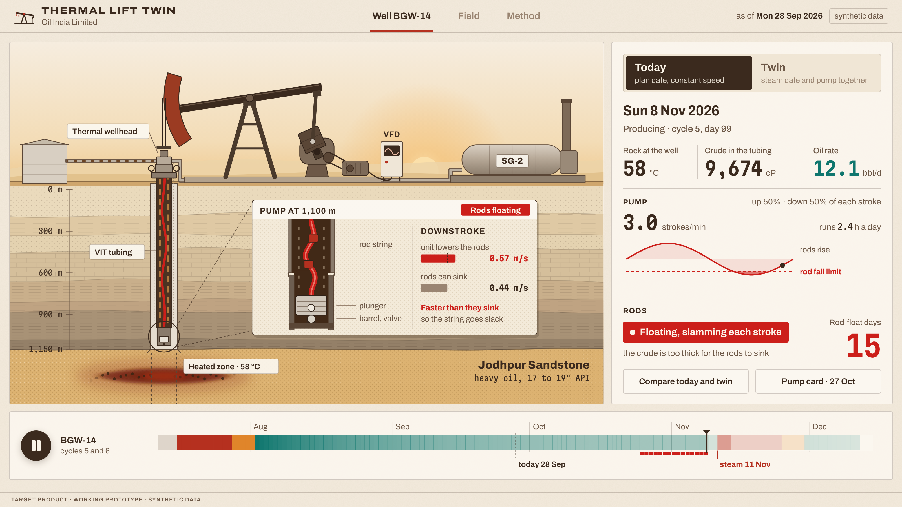

<h1 align="center">Thermal Lift Twin</h1>

<p align="center">Steam cycles and rod pumps, planned together for heavy-oil wells.</p>

<p align="center"></p>

After a steam cycle the rock cools and the crude thickens.
A pump left at constant speed lowers its rods faster than they can sink, so the string goes slack and slams on every stroke.
The twin follows each well's cooling day by day, reshapes every stroke with the drive, fast up and slow down, and books the next steam on the day it pays.

| | Today | With the twin |
|---|---|---|
| Well BGW-14, rod-float days before steam | 17 | 0 |
| Well BGW-14, steam date | 11 Nov | 28 Oct |
| 19 steam wells, rod-float days a year | 250 | 0 |
| 19 steam wells, expected rod and pump failures a year | 4.41 | 2.85 |

Model results on synthetic data built from Oil India's published field figures.
A working prototype, not deployed.

## Quick start with Docker

```bash
docker compose up --build
```

The web app comes up on http://localhost:3000 and the API on http://localhost:8000, with its OpenAPI docs at http://localhost:8000/docs.
Both images carry a healthcheck.
CI builds the stack on every push and requests pages from both services.

## Local setup

You need Node 26, pnpm 10.26 and, for the API, Python 3.12 with [uv](https://docs.astral.sh/uv/).
CI runs the same versions.

```bash
pnpm install                          # web app and the TypeScript packages
(cd apps/api && uv sync --frozen)     # API and its dev tools, from uv.lock
git config core.hooksPath .githooks   # optional, turns on the pre-commit name check
```

Display names are optional.
Copy `apps/web/.env.example` to `apps/web/.env.local` to set them, as [Configuration](#configuration) explains.

## Run

```bash
pnpm dev     # web app with hot reload on http://localhost:3000
pnpm api     # API on http://localhost:8000
```

`/` redirects to the story at `/story`.
The 3D version is at `/story-3d`, and the engineering screens start at `/calendar`.

For a production build of the web app, run `pnpm build && pnpm start`, or `make demo` to install, build and start in one step.

## Test

```bash
pnpm test        # vitest, the packages, the web app and the recording helpers
pnpm coverage    # the same suite with coverage floors
pnpm test:api    # pytest with coverage, from apps/api
pnpm check       # name check, typecheck, lint, tests, then a production build
```

| Suite | Where | What it covers |
|---|---|---|
| Model | `packages/*/test` | physics anchors, the re-steam rule, scheduler and repair, reliability, the seeded field |
| Web | `apps/web/src/**/__tests__` | every engineering screen and the 2D story rendered in jsdom, the 3D story's engine and frame state, `useTwin`, logging, error reporting and the security headers |
| API | `apps/api/tests` | every route, input validation, JSON logging, and the Python scheduler against the TypeScript answer |
| Recording | `recording/*.test.ts` | zoom framing and cursor parking for the recorded takes |

Coverage floors fail the run when coverage slips.
`packages/*/src` must stay at 95% of lines, the web app's `.ts` modules and its screen, story and calendar components at 80%, everything else at 68%, and the API at 90%.
The three.js scenes need WebGL, which jsdom lacks, so they have no unit tests.
The recorded takes in `recording/` exercise them instead.

## Architecture

```
apps/web/            Next.js app: the story, the 3D story, seven engineering screens
apps/api/            FastAPI service over the same data and scheduler
packages/physics/    heated-zone cooling, viscosity, inflow, rod dynamics, dyna cards
packages/optimise/   re-steam rule, daily pump schedule, field steam plan, failure risk
packages/simulate/   seeded synthetic field history since 2017
data/demo/           the seeded dataset, written by `pnpm gen`
recording/           frame-stepped Playwright takes and the video edit
docs/                model, assumptions, data dictionary, honesty note
```

The model runs in one direction.
`physics` turns a well's steam, soak and cooling into a daily state with viscosity, inflow and rod-float ratio.
`optimise` makes the decisions on top of that state, which are the re-steam day, each day's pump setting, the field steam plan and the repair when the generators overload.
`simulate` uses both to write a seeded field history to `data/demo/`, so every run gives the same field.

The web app imports the packages as TypeScript source and computes everything in the browser from `data/demo/field.json`.
It does not call the API.
The API reads the same folder and schedules on `tables.json`, the per-cycle oil curves the TypeScript twin exported, so the two cannot disagree on physics.
Its tests replay the demo edit and must match the TypeScript repair move for move.

### Inputs, errors and logs

| Concern | Web app | API |
|---|---|---|
| Input checks | `checkDataset` on `field.json` at load, `?well=` resolved against the steam wells | pydantic models in `twin_api/models.py`, plan checks that name the bad slots |
| Logs | one JSON line per server error, from `instrumentation.ts` | one JSON line per request, with a request id |
| Errors | `error.tsx` and `global-error.tsx` show a retry screen, and browser errors go to `/api/client-errors` | unhandled errors answer 500 with the request id, and go to Sentry when `SENTRY_DSN` is set |
| Health | `GET /api/health` | `GET /health`, 503 when a dataset file cannot load |
| Metrics | none | `GET /metrics`, Prometheus |
| Headers | CSP and hardening headers from `next.config.ts` | `X-Request-ID` on every response |

### API

| Route | Returns |
|---|---|
| `GET /health` | 200 with `"status": "ok"` when `field.json`, `tables.json` and `daily.parquet` all load, else 503 naming the file that failed |
| `GET /field` | field facts, assumptions and the history summary |
| `GET /wells`, `GET /wells/{id}` | the wells, and one well's full record |
| `GET /wells/{id}/cycles` | the well's steam cycles |
| `GET /wells/{id}/telemetry?date_from=&date_to=` | daily rows, dates as `YYYY-MM-DD`, both ends inclusive |
| `GET /wells/{id}/health` | card drift, impact loading and past failures |
| `GET /failures` | the synthetic failure history |
| `GET /schedules/issued` | the plan in force |
| `POST /schedules/check` | generator load, overload days and plan value for a plan |
| `POST /schedules/repair` | a plan that fits the generators, holding the `pinned` slots |
| `GET /metrics` | Prometheus request counts and latency by route |

`apps/api/twin_api/models.py` holds the request and response schemas, and http://localhost:8000/docs publishes them.
A plan may only use issued slot ids, each once and on its own well, with `start_d` at 0 or later.
The API answers anything else with a 422 that names the slots.
Every request logs one JSON line to stderr with method, path, status, duration and a request id.
The response returns the same id in `X-Request-ID`.
With `SENTRY_DSN` set, every unhandled error also goes to Sentry with that request id, without request bodies, cookies or client IPs.

### Web server

The pages are static, so the Next.js server has two routes of its own.

| Route | Returns |
|---|---|
| `GET /api/health` | `"status": "ok"` with the app version and the seed, as-of date and generator version of the bundled dataset |
| `POST /api/client-errors` | 204 after logging a browser error report, 400 for a malformed report, 413 for one over 8 KB |

The server logs each request error as one JSON line in the API's shape, from Next's `onRequestError` hook in `apps/web/src/instrumentation.ts`.
In the browser, `apps/web/src/instrumentation-client.ts` reports uncaught errors and unhandled promise rejections to `/api/client-errors`, which logs them the same way.
Each distinct error goes once per page load, and a page sends at most 10.
A screen that throws while rendering shows `apps/web/src/app/error.tsx`, which reports the error and offers a retry and a link back to the story.

## Configuration

| Variable | Read by | Default | Purpose |
|---|---|---|---|
| `NEXT_PUBLIC_PRODUCT`, `NEXT_PUBLIC_FIELD`, `NEXT_PUBLIC_EVENT`, `NEXT_PUBLIC_PS` | web app, at build | neutral names | display names kept out of the public repo |
| `PRIVATE_TERMS` | `pnpm check:names` | none | more words to block from tracked files, separated by `\|` |
| `LOG_LEVEL` | API, web server | `INFO` | log level |
| `BGW_DATA_DIR` | API | `data/demo` | folder with `field.json`, `tables.json` and `daily.parquet` |
| `SENTRY_DSN` | API | unset | turns on Sentry error tracking; unset sends nothing |
| `SENTRY_ENVIRONMENT` | API | `development` | environment name on Sentry events |
| `NEXT_OUTPUT` | `next.config.ts` | unset | `standalone` in the web Dockerfile |
| `BASE_URL`, `VIEWPORTS` | recording scripts | `http://localhost:3000` (`3101` for the story takes), `1920x1080,1440x900` | the app and screen sizes the takes capture; a blank value keeps the default |

`apps/web/.env.example` covers the web app and the name check.
`.env.example` at the root covers `docker compose`.
`pnpm check:names` and the pre-commit hook fail if a name from `apps/web/.env.local` appears in a tracked file.

## Data

`pnpm gen` rebuilds `data/demo/` from the seed in `packages/simulate/src/fixture.ts`.
CI regenerates it on every push and fails if the committed files differ.
[docs/data-dictionary.md](docs/data-dictionary.md) lists every field.

## CI

`.github/workflows/ci.yml` runs on every push to `main` and every pull request.

| Job | Runs |
|---|---|
| Lint | `pnpm lint` |
| Typecheck | `pnpm typecheck` |
| Tests with coverage | `pnpm coverage` |
| Seeded data and build | `pnpm gen` with a diff check, then `pnpm build` |
| API lint, typecheck and tests | `ruff check`, `ruff format --check`, `mypy`, `pytest --cov` |
| Dependency audit | `pnpm audit --audit-level=high`, and `pip-audit` on `uv.lock` |
| Secret scan | gitleaks over the full history |
| Docker stack | `docker compose up --build --wait`, then requests to both services |

`.github/workflows/codeql.yml` runs CodeQL's security-extended queries over the TypeScript and the Python on every push, every pull request and once a week.

Dependabot opens weekly update PRs for npm and uv, and monthly ones for GitHub Actions.

## More

[Model](docs/model.md) · [Assumptions](docs/assumptions.md) · [Data dictionary](docs/data-dictionary.md) · [Honesty note](docs/honesty.md) · [Contributing](CONTRIBUTING.md)

<sub>MIT licensed. Team 2, Saveetha Engineering College.</sub>
